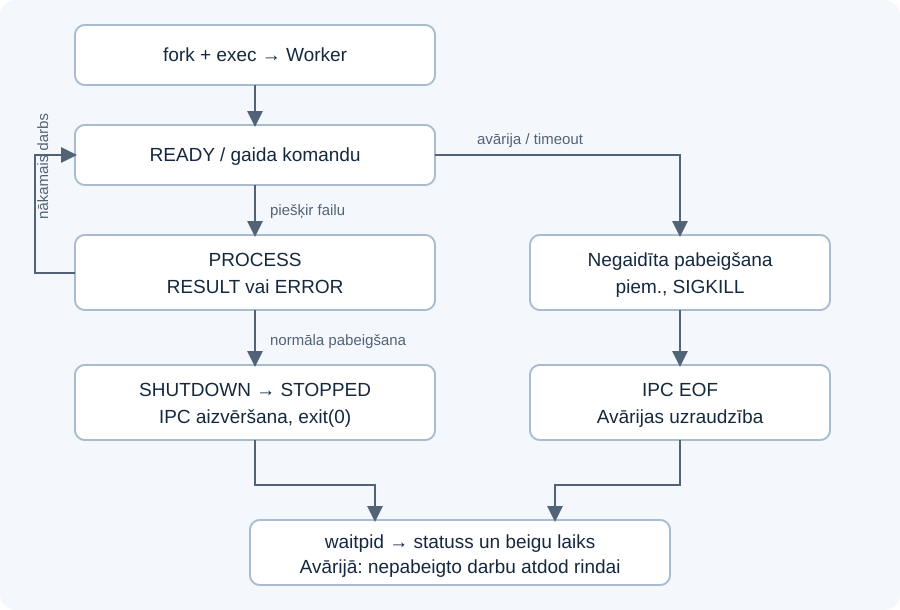

# Laboratorijas darbs Nr. 1

## Procesu pārvaldnieks: procesi, IPC, prioritātes un konfigurācija

Kurss: Operētājsistēmas un sistēmprogrammēšana, 2026.  
Platforma: Linux. Valoda: C++17.  
Autors: ____________________  Grupa: ____________________

## 1. Mērķis un arhitektūra

Izveidota lietotāja režīma sistēmprogramma `oslab`. Tā darbojas Supervisor vai Worker režīmā. Supervisor nolasa INI konfigurāciju un ar `fork` un `execl` palaiž 3–5 atsevišķus Worker procesus. Katram Worker ir neatkarīgs PID un savs AF_UNIX ligzdas galapunkts. Worker nav pavedieni; lietojumā nav augsta līmeņa procesu vai IPC ietvaru.

Supervisor vienreiz uzskaita apstrādes direktorija parastos failus un ievieto tos sakārtotā darbu rindā. Katram brīvam Worker piešķir vienu failu. Atbildes saņem ar `poll` un neblokējošu `recv`, tāpēc viena procesa lēna darbība nebloķē citu procesu rezultātus. Worker ar `open`, `fstat` un `read` aprēķina baitu skaitu, rindu skaitu un FNV-1a 32 bitu kontrolsummu. Tukšam failam ir 0 rindas; pēdējā rinda tiek ieskaitīta arī bez newline.

Darbu saraksts nav rekursīvs. Simboliskas saites, direktoriji un speciālie faili netiek apstrādāti. Ja fails pazūd pēc saraksta izveides, Worker nosūta kļūdu. Kontrolsumma ir vienkārša datu pārbaude, nevis kriptogrāfiska autentiskuma pārbaude.

## 2. Izmantotie OS API

| Joma | API un pielietojums |
|---|---|
| Procesi | `fork`, `execl`, `getpid`, `waitpid(WNOHANG)`; kļūdas gadījumā bērnā `_exit` |
| IPC | `socketpair(AF_UNIX, SOCK_SEQPACKET)`, `send`, `recv`, `poll`, `fcntl` |
| Prioritātes | `setpriority(PRIO_PROCESS, 0, value)`, `getpriority` |
| Konfigurācija | `mkdir`, `open`, `read`, `write`, `fsync`, `close` |
| Failu apstrāde | `opendir`, `readdir`, `fstatat`, `closedir`, `open`, `fstat`, `read`, `close` |
| Uzraudzība | `sigaction`, `kill`, `waitpid`, WIFEXITED/WEXITSTATUS/WIFSIGNALED/WTERMSIG |
| Kļūdas un laiks | `errno`, `strerror`, `localtime_r`, `strftime`, `nanosleep` demonstrācijas aizturei |

C++ konteineri un virknes izmantotas parsēšanai un stāvokļu uzskaitei. Tās neaizvieto nevienu prasīto OS mehānismu. `system`, shell komandas, `std::fstream` un procesu/IPC wrapperi programmas pirmkodā netiek izmantoti.

## 3. IPC protokols

Katram Worker Supervisor pirms `fork` izveido atsevišķu AF_UNIX SOCK_SEQPACKET ligzdu pāri. Abi galapunkti ir divvirzienu. Supervisor atstāj savu galapunktu, bet Worker galapunkta FD numuru un Worker ID nodod `exec` argumentos. Visi citi lietojuma FD ir CLOEXEC; tikai Worker paša IPC galapunkts saglabājas pēc `exec`.

Viena `send` operācija nosūta vienu tekstuālu protokola ierakstu. SOCK_SEQPACKET saglabā ierakstu robežas; newline terminators nav vajadzīgs. Maksimālais ieraksta lielums ir 16 384 baiti. `recv` ar MSG_TRUNC ļauj atklāt pārmērīgi lielu paketi. Ziņojumu laukus atdala ASCII atstarpe. Ceļi un kļūdu apraksti ir mazo burtu hex kodēti baiti, kas izslēdz atstarpju un jaunrindu konfliktus protokolā.

| Virziens | Formāts | Nozīme |
|---|---|---|
| Supervisor → Worker | `PROCESS <path_hex>` | Apstrādāt vienu failu |
| Supervisor → Worker | `SET_PRIORITY <LOW\|NORMAL\|HIGH>` | Mainīt paša Worker nice vērtību |
| Supervisor → Worker | `SHUTDOWN` | Pabeigt darbu un aizvērt IPC |
| Worker → Supervisor | `READY <id> <pid>` | Worker sākotnēji gatavs |
| Worker → Supervisor | `RESULT <bytes> <lines> <fnv1a32>` | Faila rezultāts, skaitļi decimāli |
| Worker → Supervisor | `PRIORITY <level> <actual_nice>` | Apstiprināta prioritātes maiņa |
| Worker → Supervisor | `ERROR <PROCESS\|PRIORITY\|PROTOCOL> <errno> <message_hex>` | Kļūdas kategorija, kods un apraksts |
| Worker → Supervisor | `STOPPED <id>` | Saņemta SHUTDOWN; Worker beidz darbu |

Vienam Worker vienlaikus ir tikai viens nepieņemts faila rezultāts, tāpēc Supervisor rezultātu sasaista ar savā atmiņā glabāto attiecīgā Worker faila ceļu. Atsevišķs darba ID šim protokolam nav nepieciešams. Prioritātes atbildes atšķiras no failu rezultātiem un neatbrīvo faila darba vietu.

Ja Worker apstrādā failu, prioritātes vai pabeigšanas komanda tiek apstrādāta pēc pašreizējā darba. Tā nav asinhrona prioritātes pārtraukšana faila vidū. Saņemšanas galapunkti Supervisor pusē ir nonblocking. Pilna sūtīšanas rinda dod apstrādātu EAGAIN, nevis bloķē Supervisor. Normālā protokolā vienlaikus tiek gaidīts ne vairāk kā viens faila rezultāts uz Worker; konsoles komandas var pievienot papildu ierakstus.

## 4. Konfigurācija

Konfigurācija atrodas `$HOME/.config/tsi-os-lab1/config.ini`. `--init` to izveido ar režīmu 0600, izmantojot `open(O_CREAT|O_EXCL)`, `write`, `fsync` un `close`. Esošs fails netiek pārrakstīts. Lasīšanai tiek lietots `open/read/close`; teksta sadalīšana INI sekcijās notiek C++ kodā.

```ini
[supervisor]
workers=3
directory=/home/student/os-lab1-linux/data
log=/home/student/.config/tsi-os-lab1/supervisor.log

[priorities]
worker1=NORMAL
worker2=NORMAL
worker3=NORMAL
```

Worker skaitu pārbauda intervālā 3–5; nepieciešama katra Worker prioritāte. Noraida nezināmas, dublētas un trūkstošas atslēgas, nederīgas prioritātes un relatīvus ceļus. Maksimālais INI lielums ir 64 KiB. Izmaiņas stājas spēkā nākamajā programmas palaišanā. INI ceļiem nedrīkst izmantot pēdiņas vai `~` saīsinājumu. Konfigurācijas mapes jābūt pieejamām pašreizējam lietotājam.

## 5. Prioritātes eksperiments

Līmeņi: LOW = nice 10, NORMAL = nice 0, HIGH = nice −5. Mazāka nice vērtība nozīmē augstāku plānošanas prioritāti. Pēc Supervisor komandas Worker izsauc `setpriority` sev un pēc sekmēm pārbauda faktisko vērtību ar `getpriority`. Pirms `getpriority` errno tiek notīrīts, jo negatīva atgrieztā vērtība var būt korekta prioritāte.

Automatizētajā eksperimentā LOW izmaiņa izdevās un tika saņemts `PRIORITY LOW 10`. Pēc tam HIGH un atgriešanās NORMAL tika atteiktas ar errno 13 (EACCES). Abas kļūdas tika reģistrētas, un Worker palika dzīvs. Šajā testēšanas vidē UID bija 0 izolētā lietotāju telpā, bet efektīvo capabilities nebija; tas nebija pilntiesīgs hosta root. Tādēļ šis rezultāts demonstrē reālu OS atļauju atteikumu, nevis mākslīgi ģenerētu ERROR.

Citā Linux vidē rezultātu nosaka lietotāja tiesības, CAP_SYS_NICE un RLIMIT_NICE. Atteikuma kods var atšķirties. Aizstāvēšanā ieteicams palaist programmu bez sudo; ja prioritātes paaugstināšana ir atļauta, programma korekti reģistrē sekmes.

## 6. Uzraudzība un procesa dzīves cikls

Žurnālā tiek fiksēts Worker ID, PID, sākuma un beigu laiks, komandas, atbildes, kļūdas un iziešanas statuss. Laika zīmogos ir vietējais laiks un UTC nobīde. Supervisor vispirms nolasa visus pieejamos ziņojumus līdz IPC EOF un tikai tad ar `waitpid` fiksē procesa pabeigšanos. Tas nepieļauj pēdējā RESULT vai STOPPED zaudēšanu procesa ātras iziešanas dēļ.



Normālais ceļš: fork/exec → READY → PROCESS → RESULT/ERROR → gatavs nākamajam failam → SHUTDOWN → STOPPED → IPC EOF → waitpid. Ja Worker tiek nogalināts, Supervisor saņem EOF, iegūst signāla statusu ar waitpid, ieraksta UNEXPECTED_EXIT un nepabeigto failu nodod atlikušajiem Worker. Ja visi Worker ir zuduši, programma beidzas ar kļūdu.

## 7. Kļūdu scenāriji un resursi

- Trūkstoša vai nekorekta konfigurācija: skaidrs FATAL, izejas kods 1; Worker netiek palaisti.
- Worker piespiedu SIGKILL: Supervisor paliek dzīvs, reģistrē signālu un pārplāno nepabeigto failu. Kods 2 saglabā avārijas faktu arī tad, ja visi faili vēlāk apstrādāti.
- Fails pazūd: Worker nosūta ERROR PROCESS ar errno; pārējie faili turpina apstrādi. Kļūdains fails netiek atkārtots bezgalīgi.
- Prioritātes maiņa aizliegta: ERROR PRIORITY ir sagaidāms eksperimenta rezultāts, nevis Supervisor avārija.
- Iestrēdzis starts/darbs: pēc konfigurējama CLI termiņa (noklusēti 60 s) Worker nogalina un sagaida. Garām apstrādēm termiņu var palielināt.
- Pabeigšana kavējas: pēc 3 s izmanto SIGKILL; atlikušos procesus sagaida ar waitpid. Agrīnas pabeigšanas gadījumā var palikt neapstrādāti faili.
- SIGINT/SIGTERM: signāla apstrādātājs maina tikai sig_atomic_t karogu; žurnāls un sakopšana notiek galvenajā ciklā.
- Sūtīšana mirušam Worker: MSG_NOSIGNAL un ignorēts SIGPIPE neļauj pēkšņi pārtraukt Supervisor; errno tiek apstrādāts.

FD īpašumtiesības pārvalda move-only RAII klase. Darba faila FD aizveras pēc faila komandas, IPC FD — pēc EOF vai kļūdas, žurnāls — pēc Supervisor beigām. Socketpair nav ceļa failu sistēmā, tāpēc nav atstāto nosaukto IPC objektu. Ārkārtas C++ izņēmuma gadījumā Children destruktors nogalina un ar waitpid sagaida atlikušos bērnus. Šī sakopšana nevar izpildīties, ja pats Supervisor saņem SIGKILL vai pazūd barošana; šie gadījumi nav normālas SHUTDOWN garantija.

## 8. Testēšana un ierobežojumi

Pievienoti 12 integrācijas testi un to faktiskie žurnāli. Tie pārbauda 3 un 5 Worker, rezultātu pareizību arī bināriem/tukšiem failiem un sarežģītiem nosaukumiem, prioritātes atteikumu, SIGKILL un darba atkārtošanu, pazudušu failu, SIGTERM, pabeigšanas timeout, nederīgu konfigurāciju, drošu --init, visu Worker zudumu, tukšu direktoriju un darba timeout. Prioritātes testā katram dīkstāves Worker bija 4 FD: 0, 1, 2 un savs IPC; komandas skaitu nepalielināja.

Detalizēta vide un rezultāti ir `TESTESANA.md`. Testi apliecina novēroto uzvedību pieejamajā Linux x86_64 vidē; tie nav garantija visām Linux konfigurācijām, arhitektūrām vai fiziski bojātai aparatūrai. Īpašas tīkla failu sistēmas un neatceļama kodola I/O gaidīšana nav pārbaudītas. Darbs ir paredzēts maziem lokāliem laboratorijas failiem. ARM64 nav atsevišķi izpildīts; pirmkods nesatur x86 specifisku kodu, un mērķa datorā jākompilē ar make.

Pirms iesniegšanas jāaizpilda autora un grupas lauki un jāpielāgo iesniegums kursa vispārīgajām prasībām. Spēja izskaidrot fork/exec, FD mantošanu, IPC protokolu, errno, prioritātes un waitpid ir aizstāvēšanas daļa.
